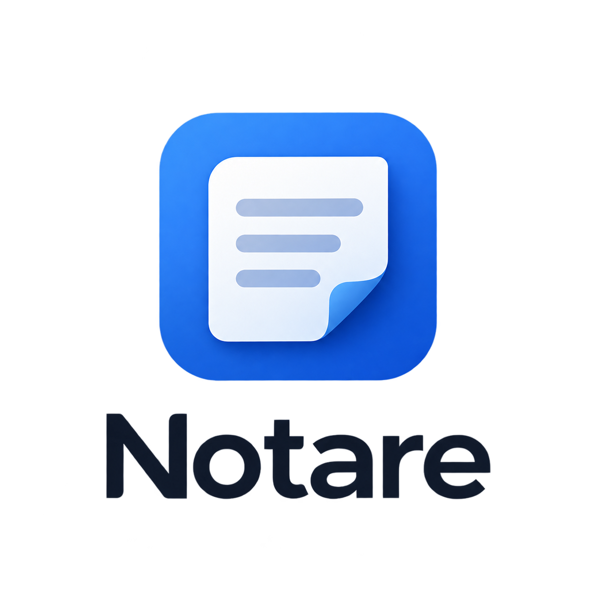

# Notare

<p align="center">
  
</p>

**Notare**  — персональный дневник с локальным хранением и синхронизацией между устройствами.

## Идея

Заметки и папки хранятся **локально** на каждом устройстве (ПК и телефон). Синхронизация — **напрямую**, без облака и без подписок. Работает **офлайн**.

## Стек

- **Backend:** ASP.NET Core (C#) + SQLite + EF Core
- **Desktop:** Avalonia UI (C#) + MVVM
- **Mobile:** .NET MAUI (C#) — Android
- **Синхронизация:** HTTP + WebSocket (мгновенный push)
- **.NET 10**

- **Сервер** — на ПК, отвечает за синхронизацию.
- **Десктоп** — сам поднимает сервер (если он не запущен) и работает с ним напрямую.
- **Телефон** — локальная SQLite + синк с сервером.
- **WebSocket** — сервер пушит клиентам «есть изменения» → мгновенный синк.
- **Работа без сервера** — телефон работает с локальной базой, синк при возврате.

## Функционал

- Папки и заметки (CRUD)
- Вложенные папки — папка внутри папки на любую глубину: на главном экране
  корневые, внутри папки — её подпапки, сверху крошки «Главная / Работа / Проект»
  (тап кликает), «назад» поднимает на уровень выше; при удалении папки сервер
  и оба клиента удаляют всё её поддерево (подпапки и заметки), undo возвращает
  дерево целиком
- Локальная SQLite на телефоне
- Синхронизация ПК ↔ телефон через WebSocket (мгновенная)
- Soft delete (безопасное удаление) с подтверждением и undo в течение 5 секунд
- Поиск по названию и тексту — папки и заметки
- Группировка заметок по датам («Сегодня» / «Вчера» / дата) с датой на карточках
- Автосохранение
- Десктоп: сервер поднимается при запуске приложения и перезапускается при падении
- Десктоп: сворачивание в трей (крестик прячет окно, выход — из меню трея,
  сервер продолжает работать для телефона)
- Десктоп: «Запускать с Windows» и ярлык на рабочем столе — пункты меню ⋮
  (ярлык создаётся при первом запуске, автозапуск выключен по умолчанию)
- Десктоп: тема оформления — светлая / тёмная / системная (меню ⋮)
- Десктоп: экспорт всех данных в JSON-бэкап (меню ⋮)
- Десктоп: проверка орфографии в редакторе — русский и английский словари
  встроены (работают без интернета), ошибки подчёркиваются красной волнистой
  линией, правый клик по слову предлагает замены, «Игнорировать» (до перезапуска)
  и «Всегда игнорировать» (слово сохраняется в отдельном файле)
- Телефон: адрес сервера настраивается из меню ⋮ — синк не ломается при смене IP у ПК
- Надёжный синк: WebSocket переподключается после обрыва, синк при возврате
  приложения из фона, «Обновить данные» показывает, есть ли связь с ПК

## Тесты

```bash
dotnet test Diary.slnx        # всё сразу
dotnet test Diary.Server.Tests
dotnet test Diary.Desktop.Tests
```

Либо двойной клик по `run-tests.bat` — прогон с замером покрытия,
отчёт появится в `TestResults\*\coverage.cobertura.xml`.

Интеграционные тесты сервера (xUnit + WebApplicationFactory + coverlet) покрывают:
`/ping`, CRUD `/notes`, CRUD `/folders` с каскадом, вложенность папок
(защита от циклов, каскадное удаление поддерева), `restore` для удалённых
заметок и папок, `/folders/{id}/notes`, `/sync`, `/ws` (push-уведомления),
`/admin/fix-updated-at`.

Особенности:

- тесты поднимают настоящий сервер на **временной базе в `%TEMP%`** —
  рабочий `diary.db` не открывается и не изменяется;
- каждый тест получает свой экземпляр сервера и свою БД (полная изоляция);
- `Diary.Desktop.Tests` — юнит-тесты сервиса проверки орфографии (12 тестов).

Текущее покрытие: **~61% строк** `Diary.Server` (49 тестов сервера + 12 тестов десктопа).


